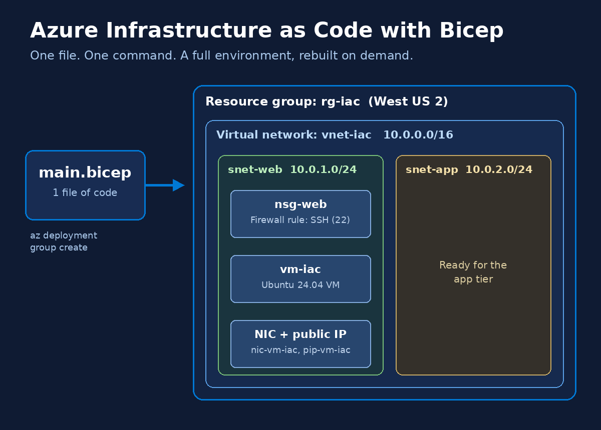
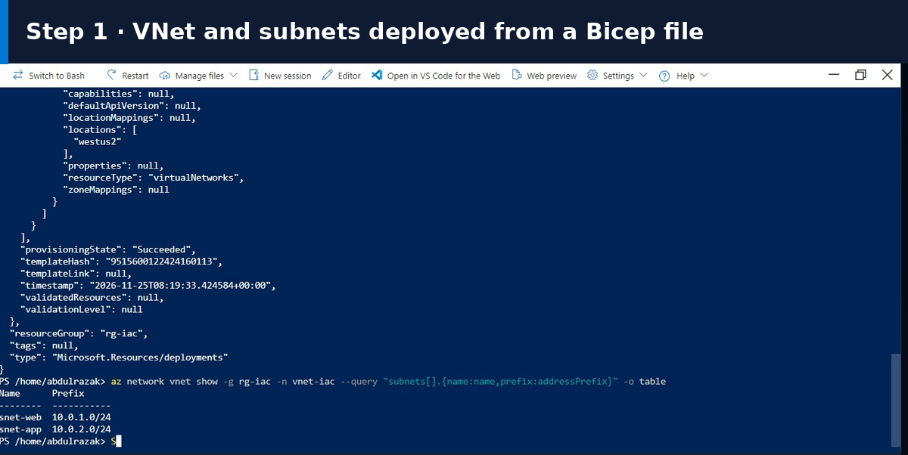
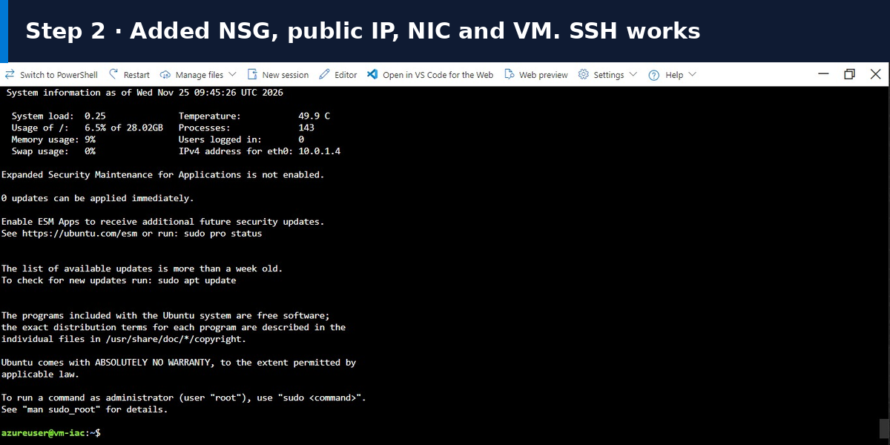
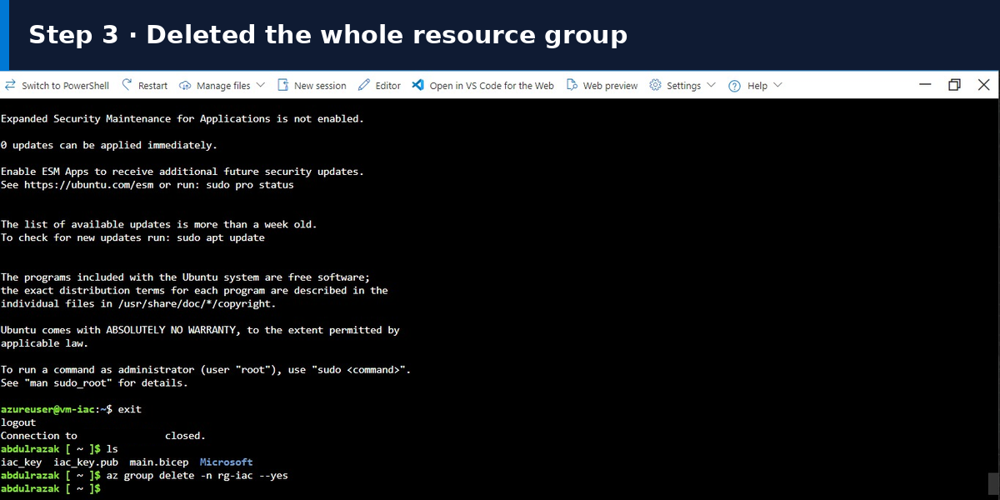
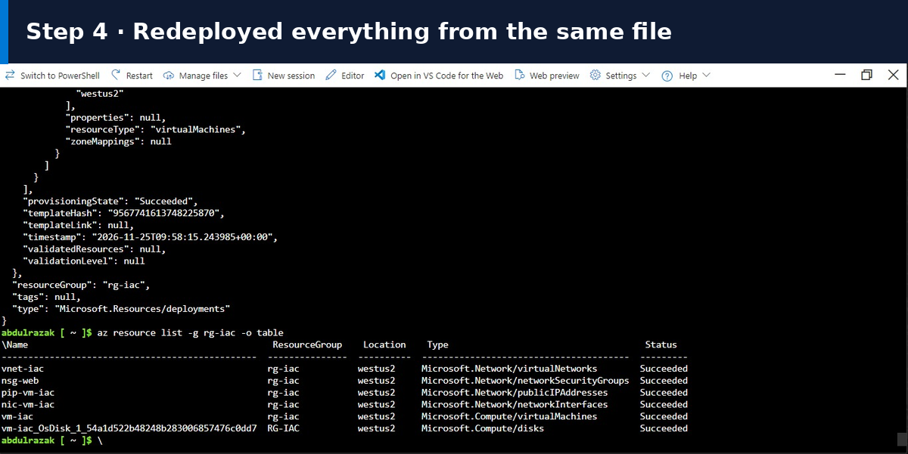
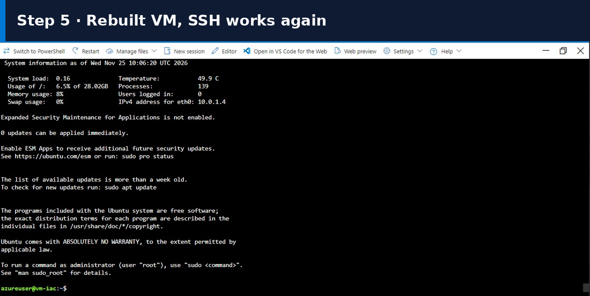

# Azure Infrastructure as Code with Bicep

Deploy a small Azure network and a Linux VM from a single Bicep file, delete it all, and rebuild it with one command.



## What it deploys

All resources go into one resource group, `rg-iac` (West US 2).

| Resource | Name | Details |
|---|---|---|
| Virtual network | `vnet-iac` | `10.0.0.0/16` |
| Subnet | `snet-web` | `10.0.1.0/24`, NSG attached |
| Subnet | `snet-app` | `10.0.2.0/24` |
| Network security group | `nsg-web` | Allows inbound SSH (port 22) |
| Public IP | `pip-vm-iac` | Standard SKU, static |
| Network interface | `nic-vm-iac` | In `snet-web`, with the public IP |
| Virtual machine | `vm-iac` | Ubuntu 24.04 LTS, `Standard_D2als_v6`, SSH key login only |

## Prerequisites

- An Azure subscription
- Azure Cloud Shell (Bash), which already has the Azure CLI and Bicep
- An SSH key pair

## Deploy

```bash
# 1. Create an SSH key (no passphrase) and read the public key
ssh-keygen -t ed25519 -f ~/iac_key -N ""
key=$(cat ~/iac_key.pub)

# 2. Create the resource group
az group create -n rg-iac -l westus2

# 3. Deploy the template
az deployment group create -g rg-iac -f main.bicep -p sshKey="$key"
```

## Test

Look for `"provisioningState": "Succeeded"`, then list what was created:

```bash
az resource list -g rg-iac -o table
```

Connect to the VM:

```bash
ssh -i ~/iac_key azureuser@$(az vm show -d -g rg-iac -n vm-iac --query publicIps -o tsv)
```

## Tear down and rebuild

```bash
az group delete -n rg-iac --yes
az group exists -n rg-iac        # prints false when it's gone
```

Then run the three deploy commands again. The same file rebuilds the same environment.

## Screenshots

| Step | Screenshot |
|---|---|
| VNet and subnets deployed |  |
| NSG, public IP, NIC and VM added, SSH works |  |
| Whole resource group deleted |  |
| Everything redeployed from the same file |  |
| Rebuilt VM, SSH works again |  |

## Troubleshooting notes

- **`BCP028: Identifier "nic" is declared multiple times`:** a resource block was pasted into the file twice. Bicep needs every symbolic name to be unique, so I removed the duplicate block.
- **Large pastes scrambled in Cloud Shell:** I built the file in four smaller pieces with `cat >> main.bicep`, then checked it with `grep '^resource' main.bicep`.
- **`Sssh-keygen` not recognized:** a typo. The error message suggested the right command.

## Notes and next steps

- SSH is open to the whole internet (`*`) so this lab is easy to test. In a real environment, restrict the source to your own IP or use Azure Bastion.
- Never commit the private key (`iac_key`). Add it to `.gitignore`.
- Next: add Azure Monitor alerts, Key Vault, and backups to the same template.
- Delete the resource group when you're done so the VM doesn't keep running.
